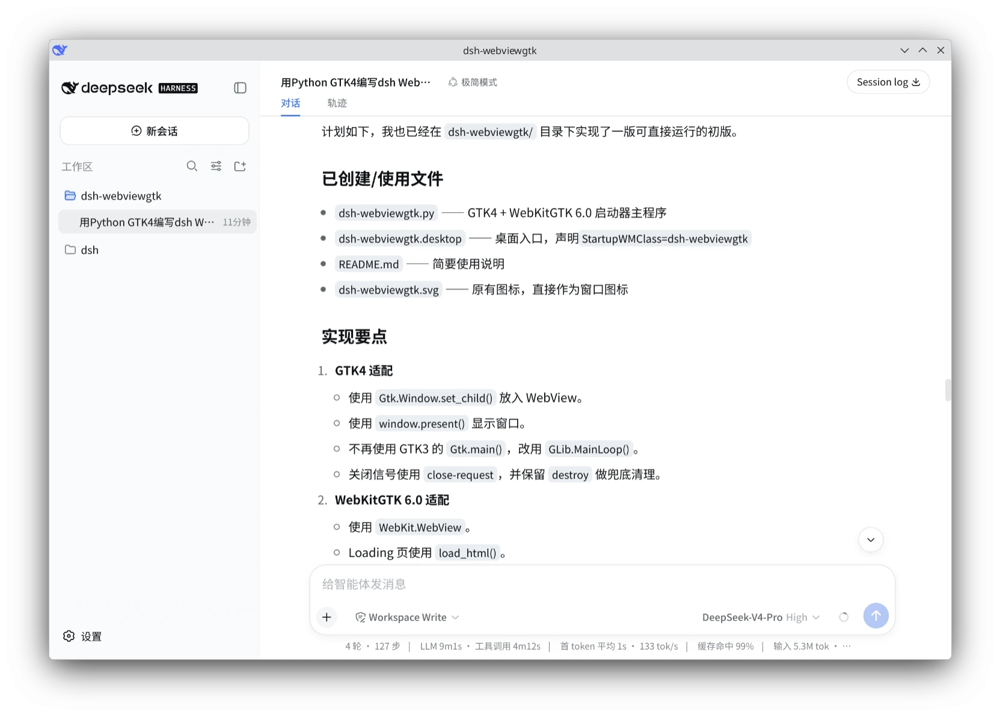

# dsh-webviewgtk

基于 GTK4 + WebKitGTK 6.0 的 dsh web 启动器。

可以作为 [deepseek-harness](https://github.com/deepseek-ai/deepseek-harness/) 的 gtk4 desktop 桌面版使用。

注：这只是一个启动器，不包含 dsh，也不预装任何额外插件，

启动时会执行 `npx --loglevel verbose --yes @deepseek-ai/dsh web --no-open --port 0`

目的是保证使用的是最新版官方 dsh。

## 截图



## 依赖

Debian/Ubuntu：

```bash
sudo apt install python3-gi gir1.2-gtk-4.0 gir1.2-webkit-6.0
```

还需要 `npx` 命令在 `PATH` 中。

## 下载

```bash
git clone https://github.com/shellexy/dsh-webviewgtk.git
cd dsh-webviewgtk
```


## 直接运行

```bash
python3 dsh-webviewgtk.py
```

启动后会：

1. 打开 WebKitGTK 窗口，显示居中的图标和 `Loading...`；
2. 以子进程启动 `npx --loglevel verbose --yes @deepseek-ai/dsh web --no-open --port 0`，由 dsh 自动选择空闲端口；
3. 把 dsh 的标准输出/错误同时显示在 Loading 页和终端，日志区域自动滚动到底部；
4. 从 dsh 输出中解析带 token 的访问地址（例如 `dsh web: http://127.0.0.1:54321/?token=...`，端口由 dsh 自动选择），解析成功后自动加载该地址；
5. 支持从系统剪贴板粘贴图片到网页输入框；
6. 点击外链或请求新窗口的链接时，使用系统默认应用打开（支持 http、https、mailto、tel、ftp、magnet 等协议）；
7. 网页下载时弹出保存对话框；
8. 窗口不在前台时弹出系统桌面通知（见下节）；
9. 关闭窗口时结束整个 dsh 进程树；
10. 单实例运行：重复启动只会激活已有窗口，不会再次启动 dsh。

## 开发者工具

按 **F12** 或 **Ctrl+Shift+I** 打开/收起 WebKit 的开发者工具（停靠在窗口内，含 Console、
Elements、Network），加载页阶段也可以打开，用于排查页面或通知桥的问题。

## 桌面通知

dsh 官方 web UI 目前自己不产生任何通知，因此外壳在文档开始注入一段桥脚本，由它把
dsh 页面自己的会话状态翻译成桌面通知：

- **一轮回复结束**：dsh 客户端用一对转发事件参数（`sessionId`, `running`）驱动它自己的
  会话状态；桥脚本包住 `MessageEvent.data` 观察这条流，**只看参数形状、不绑定事件名**，
  `running` 变为 `false` 即本轮结束。
- **在等你授权 / 在等你回答**：以页面上出现的待处理面板为准——dsh 自己给它们打的稳定标识
  `[data-approval-key]`（权限审批）、`[data-question-key]`（`ask_user` 提问）、
  `[data-plan-review-key]`（计划确认）。桥用 `MutationObserver` 加 1 秒轮询发现，**完全不依赖
  任何 dsh 事件名**；同一轮 `ask_user` 的多道题按"面板 key 去掉序号"归并为一次请求，只通知一次，
  新的一次请求再通知。会话 id 取侧栏当前选中会话，点击通知即可切回去。
  实测某些 dsh 版本并不把这类等待以"转发瀑布"送到浏览器，所以 DOM 是主路径；如果哪天真
  收到 `approval/request` / `user-questions/request` 瀑布帧，它只用来把标题说得更准
  （在等你批准 / 在等你回答），并覆盖"后台会话在等你、面板不在当前视图"这一种情况。
- 窗口在前台且通知属于当前正在看的会话时**不打扰**；点击通知会聚焦窗口并切到该会话；
  回到应用即视为已读，撤回本次运行弹出的通知。

关闭方式：在页面控制台执行 `globalThis.__DSH_SHELL_NOTIFY_DISABLE__ = true`；
也可在 `dsh_webviewgtk.py` 里改 `BRIDGE_JS_TEMPLATE` 中的 `PENDING_MARKERS`（DOM 选择器）、
`PENDING_TRIGGERS`（瀑布事件名，可选）与 `PENDING_POLL_INTERVAL_MS` 以适配后续 dsh 版本。

通知桥依赖 dsh 内部的两类事实：转发事件里 `(sessionId, running)` 的参数约定（不绑定名字），
以及上述 `data-*` 面板属性。dsh 升级后若某类通知不再出现，先在页面控制台确认这两者。

### 实现中踩过的坑（改动前请先读）

1. **注入时机**：桥在 `UserScriptInjectionTime.START` 注入，那一刻 `<div id="root">` 还**不存在**。
   扫描器因此不能以 `#root` 为前提，只能挂在 `documentElement` 上并等 `DOMContentLoaded`
   （`installScanner`）。早期版本用 `getElementById('root') === null` 直接 return，导致扫描器
   从未安装、除"完成"以外的通知全部无声失效。
2. **来源校验的空窗**：`load_uri` 刚发出时 `get_uri()` 为空，此时桥已经在报到。校验必须先解析
   载荷、只对会驱动外壳动作的 `completed` / `pending` 校验来源，并在空 URI 时以"是否加载过
   dsh 地址"（`_trusted_uri`）为准，否则真实通知会被自己的校验丢掉。
3. **日志级别**：WebKit 检查器默认可能过滤 `console.debug`，桥的日志用 `console.log`。
4. **不要静默 `catch`**：桥的每一步失败都通过 `kind: 'diagnose'` 回传终端，否则一个异常就会让
   整类通知消失且毫无线索。`DSH_WEBVIEWGTK_DEBUG=1` 时这些诊断会逐句打印。
5. **载荷类型**：`script-message-received` 回调拿到的既可能是 JSON 文本、也可能是已反序列化的
   对象，`_parse_script_message` 两种都接受。

### 排查

```bash
# 外壳侧：打印实际注入的桥脚本、收到的每条载荷，以及被丢弃的原因；
# 同时把页面侧调试强制打开（每次页面加载都自带），无需手动在控制台设置。
DSH_WEBVIEWGTK_DEBUG=1 python3 dsh_webviewgtk.py
```

成功时终端应出现（顺序即执行顺序）：

```
[dsh-webviewgtk] 桥诊断：bridge-start href=http://127.0.0.1:3081/…
[dsh-webviewgtk] 桥诊断：scanner-deferred readyState=loading
[dsh-webviewgtk] 桥诊断：markers 0 … none
[dsh-webviewgtk] 桥诊断：scanner-ready root=DIV interval=1000ms
[dsh-webviewgtk] 桥诊断：markers 1 <会话id> <面板key>      ← 卡片出现
[dsh-webviewgtk] 收到页面通知载荷：{'kind': 'pending', …}
桌面通知：DeepSeek Harness 在等你 — 有新的待处理交互
```

`scanner-ready root=none` 或缺少该行，说明扫描器没装上（见上面第 1 条）。

页面侧（打开 dsh 页面的开发者控制台）：

```js
typeof globalThis.__DSH_SHELL_NOTIFY__        // 'function' = 桥在跑；'undefined' = 桥没注入
globalThis.__DSH_SHELL_NOTIFY_DEBUG__ = true  // 每条观察到的帧 + 每 5 秒一次心跳自证
globalThis.__DSH_SHELL_NOTIFY_DISABLE__ = true // 关闭桌面通知
```

- 终端里**没有** `[dsh-webviewgtk] 已注入的通知桥脚本`：跑的是旧安装副本
  （`pip show -f dsh-webviewgtk` 能看到已安装的位置），重新安装或用 `python3 dsh-webviewgtk.py` 跑仓库版本。
- 终端里**没有** `收到页面通知载荷`：桥脚本没跑起来或消息通道没注册（启动时应打印
  `警告：无法注册通知桥消息通道`），把控制台里 `[dsh-shell-notify]` 的输出一起看。
- 控制台里只有 `heartbeat … markers=0`、面板出现时 **没有** `pending-panel`：说明那个面板不带
  已知的 `data-*` 标识（或不在 `#root` 里）。把面板元素的 `outerHTML` 开头几百字符贴出来，
  我按它真实用的标识改 `PENDING_MARKERS`。
- 控制台里连 `heartbeat` 都没有：调试标志没设上（要设 `true`，且设置后 5 秒内应出现第一条），
  或桥没注入（先看上一行 `typeof` 的结果）。

## 安装

在仓库目录下执行：

```bash
pip install . --break-system-packages
```

或：

```bash
python3 setup.py install --user
```

安装后会提供 `dsh-webviewgtk` 命令，并安装：

- `dsh-webviewgtk` 启动命令
- `dsh-webviewgtk.svg` 图标到 hicolor 图标主题
- `com.github.shellexy.DshWebviewGtk.desktop` 到 applications 目录（与通知使用的应用 id 一致）

## 测试

```bash
python3 tests/bridge_smoke_test.py   # 通知桥脚本的解析逻辑（只需要 node）
python3 tests/notification_probe.py  # 真实弹出一条通知，验证点击回调（需要桌面会话）
```

## 图标与 StartupWMClass

- 窗口图标使用 `dsh-webviewgtk.svg`。
- 程序名/窗口类设置为 `dsh-webviewgtk`。
- `com.github.shellexy.DshWebviewGtk.desktop` 中声明了 `StartupWMClass=dsh-webviewgtk`。

## 已知问题

- **退出后打印 `corrupted double-linked list`（无害）**：只有加载过真实 dsh 页面才会出现，
  发生在主循环返回、解释器收尾之后，不影响使用。已确认与外壳逻辑无关：只建窗口的路径干净，
  打开检查器也不复现；`WEBKIT_DISABLE_DMABUF_RENDERER=1 python3 dsh_webviewgtk.py`
  可消除，因此判定为 WebKitGTK 2.52.6 退出期的 DMA-BUF 渲染缺陷。
  **不要**在主循环返回后显式 `webview.destroy()` / `window.destroy()` 试图"清理"它：
  实测会把无害提示变成段错误（核心已转储）。

各版本变更见 [CHANGELOG.md](CHANGELOG.md)。
